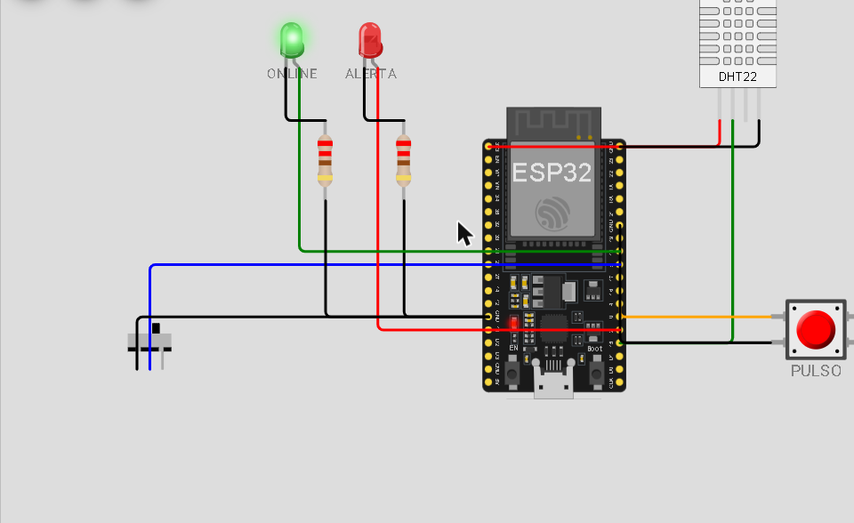
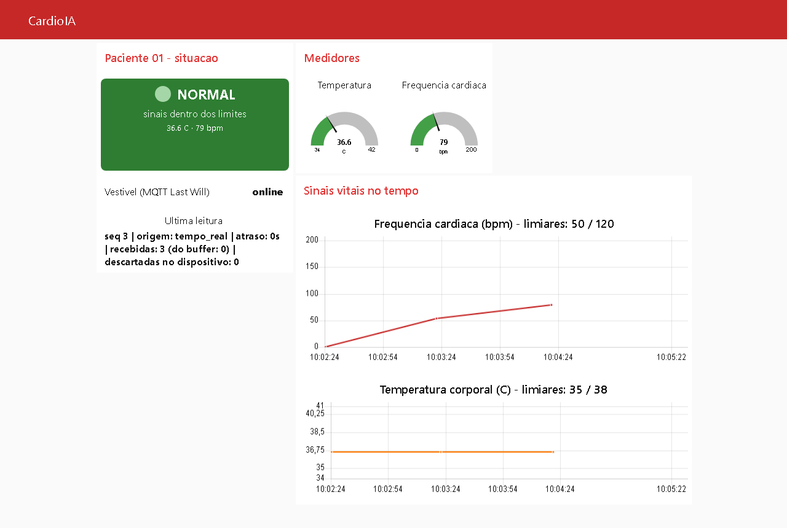
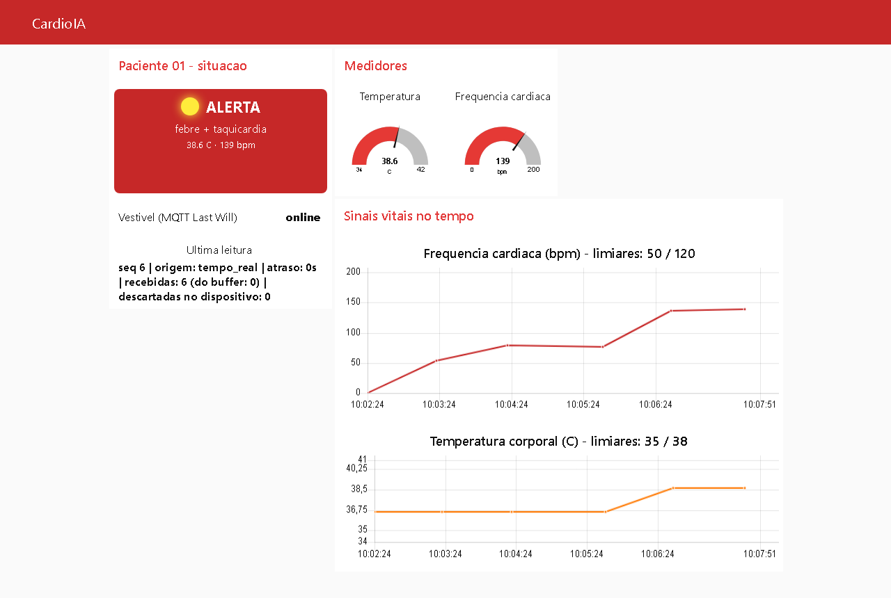
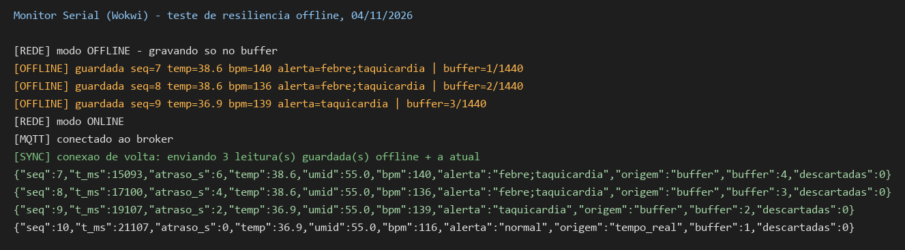
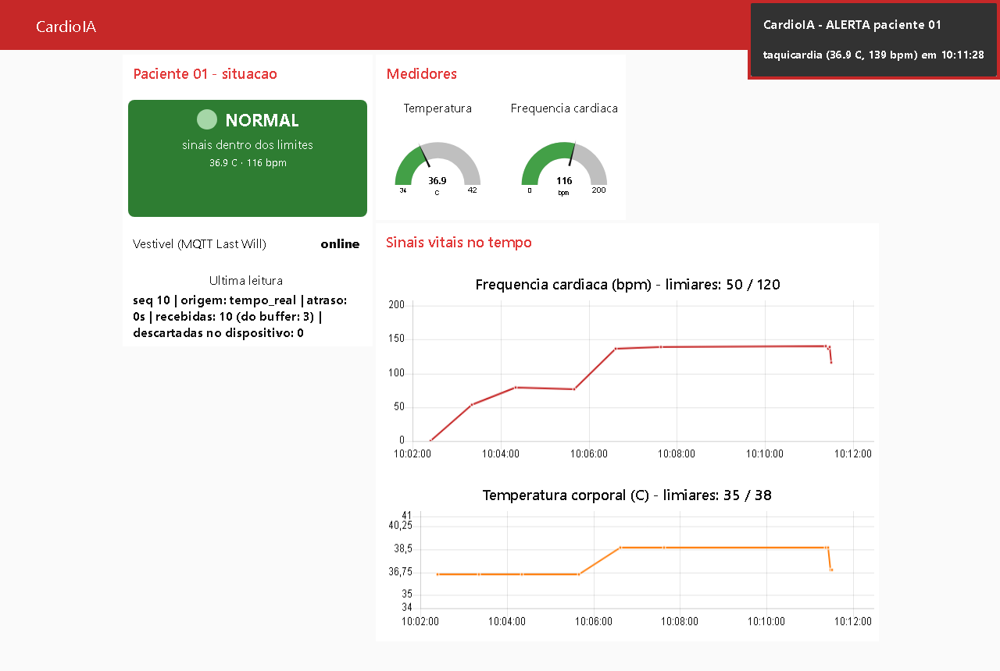

# FIAP - Faculdade de Informática e Administração Paulista

<p align="center">
<a href= "https://www.fiap.com.br/"></a>
</p>

<br>

# CardioIA Conectada — Monitoramento Contínuo: IoT na Saúde

## Grupo 78 — integrante único

## 👨‍🎓 Integrantes:
- Roberto Almeida Alvares — RM568265

## 👩‍🏫 Professores:
### Tutor(a)
- <a href="https://www.linkedin.com/in/leonardoorabona/">Leonardo Ruiz Orabona</a>
### Coordenador(a)
- <a href="https://www.linkedin.com/in/andre-godoi-chiovato-83730228/">André Godoi Chiovato</a>

## ✅ Onde está cada item do enunciado

**Atividade: Monitoramento Contínuo – IoT na Saúde** (Cap. 1 — CardioIA Conectada).
Fluxo completo: captura → processamento → transmissão → visualização → alerta.

| Item do enunciado | Onde está |
|---|---|
| **Parte 1** · Link do projeto no Wokwi | **[wokwi.com/projects/479764753805053953](https://wokwi.com/projects/479764753805053953)** |
| **Parte 1** · Código em C++ comentado | [`src/fase3/wokwi/sketch.ino`](src/fase3/wokwi/sketch.ino) · circuito: [`diagram.json`](src/fase3/wokwi/diagram.json) |
| **Parte 1** · Mínimo de 2 sensores distintos (DHT22 obrigatório + 1 de livre escolha) | DHT22 (temperatura e umidade) + botão de pulso (batimentos → BPM) — [relatório Parte 1, seção 2](document/fase3_relatorio_parte1.md#2-sensores-mínimo-de-2-distintos) |
| **Parte 1** · Conectividade Wi-Fi simulada (variável booleana) e envio via `Serial.println` apagando o local | `wifiSimulado`, controlada por chave deslizante — [seção 4](document/fase3_relatorio_parte1.md#4-simulação-da-conectividade-a-variável-booleana) |
| **Parte 1** · Resiliência offline e estratégia de armazenamento limitado | buffer circular de **1 440 leituras = 24 h** a 1 leitura/min — [seção 5](document/fase3_relatorio_parte1.md#5-lógica-de-resiliência-offline) |
| **Parte 1** · SPIFFS (opcional) | não usado: volátil no simulador; Monitor Serial como alternativa, como o enunciado permite — [seção 5](document/fase3_relatorio_parte1.md#5-lógica-de-resiliência-offline) |
| **Parte 1** · Relatório (mín. 1 página): fluxo de funcionamento e lógica de resiliência | [`document/fase3_relatorio_parte1.md`](document/fase3_relatorio_parte1.md) |
| **Parte 2** · Envio via MQTT e integração com broker (HiveMQ) | `broker.hivemq.com`, 3 tópicos, Last Will — [relatório Parte 2, seção 2](document/fase3_relatorio_parte2.md#2-o-fluxo-de-comunicação-mqtt) |
| **Parte 2** · Dashboard Node-RED: **gráfico** do sinal vital | gráficos de BPM e de temperatura — [seção 3](document/fase3_relatorio_parte2.md#3-configuração-do-dashboard-node-red) |
| **Parte 2** · Dashboard Node-RED: **medidor (gauge)** | gauges de temperatura e de BPM |
| **Parte 2** · **Indicador visual de alerta** (> 120 bpm, > 38 °C) | LED virtual + texto, e notificação automática — [seção 3.2](document/fase3_relatorio_parte2.md#32-limites-de-alerta-definidos-pelo-grupo) |
| **Parte 2** · Código do ESP32 | o mesmo `sketch.ino` (cliente MQTT incluso) |
| **Parte 2** · Prints ou export do dashboard Node-RED | export: [`src/fase3/node-red/flow_cardioia.json`](src/fase3/node-red/flow_cardioia.json) · prints: [Evidências](#-evidências) |
| **Parte 2** · Relatório (mín. 2 páginas): fluxo MQTT e configuração do dashboard | [`document/fase3_relatorio_parte2.md`](document/fase3_relatorio_parte2.md) |
| Refletir sobre eficiência, segurança e boas práticas em IoT médico | [relatório Parte 2, seção 5](document/fase3_relatorio_parte2.md#5-eficiência-segurança-e-boas-práticas-em-iot-médico) |

## 📜 Descrição

O **CardioIA** simula um ecossistema de cardiologia inteligente: dados
clínicos, Machine Learning, Visão Computacional, IoT e agentes de IA. Este
repositório reúne a **Fase 3** (Cap. 1 — *CardioIA Conectada*). As fases
anteriores estão no repositório principal do projeto:
[CardioIA — Fases 1 e 2](https://github.com/RobertoAlvares/A-Busca-de-Dados-Preparando-o-Terreno-para-a-Intelig-ncia-Cardiol-gica).

O CardioIA ganha um **vestível de monitoramento cardíaco** simulado em ESP32 no
Wokwi. Dois sensores: o **DHT22** (temperatura corporal e umidade) e um **botão
de pulso** — cada aperto é um batimento, e o ESP32 calcula a frequência cardíaca
pelos intervalos.

- **Edge (no paciente).** O ESP32 decide o alerta sozinho — febre (> 38 °C),
  taquicardia (> 120 bpm), bradicardia, hipotermia, ausência de pulso — e acende
  o LED vermelho **mesmo sem internet**. Toda leitura entra num **buffer
  circular de 1 440 registros** (24 h a 1 leitura/min). Sem conexão, ele só
  guarda; quando a conexão volta, descarrega do mais antigo para o mais novo e só
  apaga depois de enviar.
- **Cloud.** As leituras saem em JSON por **MQTT** para o broker público da
  HiveMQ, em três tópicos (`vitais`, `alerta`, `status`), com **Last Will**: se o
  vestível cair sem avisar, o broker publica `offline` por ele.
- **Fog.** Um fluxo **Node-RED** valida a leitura, recalcula o alerta com os
  mesmos limiares do dispositivo, reconstrói o horário das leituras que ficaram
  no buffer e exibe tudo num dashboard com gráficos, gauges, LED virtual de
  alerta e notificação automática.

O protótipo usa broker público sem TLS porque trafega **apenas dado simulado**;
o relatório da Parte 2 lista o que muda para dado real de paciente (TLS, ACL por
tópico, pseudônimo, segredos fora do firmware).

## 📸 Evidências

| | |
|---|---|
| Circuito no Wokwi |  |
| Dashboard em estado normal |  |
| Dashboard em alerta |  |
| Dashboard com o vestível **offline** (Last Will) |  |
| Monitor Serial: modo offline e sincronização do buffer |  |
| Volta da conexão: 3 leituras do buffer recebidas e **notificação automática** de alerta |  |

Log integral do Monitor Serial da sessão de teste:
[`assets/fase3/serial_wokwi_04-11-2026.log`](assets/fase3/serial_wokwi_04-11-2026.log).

## 📁 Estrutura de pastas

- <b>.github</b>: arquivos de configuração específicos do GitHub.
- <b>assets</b>: imagens e evidências.
  - `fase3/` — prints do circuito, do dashboard (normal, alerta, offline, sincronização) e log integral do Monitor Serial.
- <b>config</b>: arquivos de configuração (não usados nesta fase).
- <b>document</b>: documentos do projeto.
  - `fase3_relatorio_parte1.md` — Parte 1: fluxo de funcionamento e lógica de resiliência offline (edge).
  - `fase3_relatorio_parte2.md` — Parte 2: fluxo de comunicação MQTT e configuração do dashboard (fog/cloud).
- <b>scripts</b>: scripts auxiliares (não usados nesta fase).
- <b>src</b>: código-fonte.
  - `fase3/wokwi/` — firmware do ESP32 (`sketch.ino`), circuito (`diagram.json`) e bibliotecas (`libraries.txt`).
  - `fase3/node-red/flow_cardioia.json` — export do fluxo e do dashboard Node-RED.
- <b>README.md</b>: este guia.

## 🔧 Como executar o código

**Partes 1 e 2 — ESP32 no Wokwi.** Abrir o [projeto no Wokwi](https://wokwi.com/projects/479764753805053953)
(ou criar um projeto ESP32 e colar os três arquivos de `src/fase3/wokwi/`) e
clicar em ▶. Controles na simulação:

- **chave deslizante** — direita = online, esquerda = offline;
- **botão PULSO** — cada aperto é um batimento (1 por segundo ≈ 60 bpm);
- **DHT22** — clicar no sensor e ajustar a temperatura (acima de 38 °C gera alerta).

**Parte 2 — dashboard Node-RED** (requer Node.js 18+):

```bash
npm install -g node-red
cd ~/.node-red && npm install node-red-dashboard
node-red
```

Em `http://127.0.0.1:1880`: *Menu → Import* → colar
`src/fase3/node-red/flow_cardioia.json` → *Deploy*. O dashboard fica em
`http://127.0.0.1:1880/ui` e começa a mostrar dados assim que a simulação do
Wokwi estiver rodando.

## 🗃 Histórico de lançamentos

* 1.0.0 - 04/11/2026
    * Entrega da Fase 3: vestível ESP32 no Wokwi (DHT22 + pulso, alerta local,
      buffer offline de 24 h), MQTT com Last Will e dashboard Node-RED com alertas.

## 📋 Licença

<p xmlns:cc="http://creativecommons.org/ns#" xmlns:dct="http://purl.org/dc/terms/"><a property="dct:title" rel="cc:attributionURL" href="https://github.com/agodoi/template">MODELO GIT FIAP</a> por <a rel="cc:attributionURL dct:creator" property="cc:attributionName" href="https://fiap.com.br">Fiap</a> está licenciado sobre <a href="http://creativecommons.org/licenses/by/4.0/?ref=chooser-v1" target="_blank" rel="license noopener noreferrer" style="display:inline-block;">Attribution 4.0 International</a>.</p>
